# [MIMO-OFDM] Chapter 1: Free Space Path Loss in Wireless Channels and Fading[with MATLAB Code]

MATLAB code:
% Curves showing the variation of path loss in free space with distance under different antenna gains.\nclear all, clf, clc% Clear command, clear graphics, clear data\nfc=1.5e9;%Carrier frequency 1.5GHz\nd0=100;%Reference distance\nsigma=3;% Standard deviation\ndistance=[1:2:31].^2;% Distance\nGt=[1 1 0.5];%Transmit antenna gain\nGr=[1 0.5 0.5];% Accepted antenna gain\nExp=[2 3 6]; \nfor k=1:3\n   y_Free(k,:)= PL_free(fc,distance,Gt(k),Gr(k));% Path loss in free space\n   y_logdist(k,:)= PL_logdist_or_norm(fc,distance,d0,Exp(k));% Logarithmic Path Loss Model\n   y_lognorm(k,:)= PL_logdist_or_norm(fc,distance,d0,Exp(1),sigma); % Log-normal shadowing model\nend\n%Free Path Loss Model\nfigure(1);\nsemilogx(distance,y_Free(1,:),'k-o',distance,y_Free(2,:),'b-^',distance,y_Free(3,:),'r-s')\ngrid on, axis([1 1000 40 110]);\ntitle(['Free PL Models, f_c=',num2str(fc/1e6),'MHz'])\nxlabel('Distance[m]');\nylabel('Path loss[dB]');\nlegend('G_t=1, G_r=1','G_t=1, G_r=0.5','G_t=0.5, G_r=0.5');\n% Logarithmic Path Loss Model\nfigure(2)\nsemilogx(distance,y_logdist(1,:),'k-o',distance,y_logdist(2,:),'b-^',distance,y_logdist(3,:),'r-s')\ngrid on, axis([1 1000 40 110]),\ntitle(['Log-distance PL model, f_c=',num2str(fc/1e6),'MHz'])\nxlabel('Distance[m]');\nylabel('Path loss[dB]');\nlegend('n=2','n=3','n=6');\n% Log-normal shadow path loss model\nfigure(3)\nsemilogx(distance,y_lognorm(1,:),'k-o',distance,y_lognorm(2,:),'b-^',distance,y_lognorm(3,:),'r-s')\ngrid on, axis([1 1000 40 110]),\ntitle(['Log-normal PL model, f_c=',num2str(fc/1e6),'MHz, ','\sigma=', num2str(sigma), 'dB'])\nxlabel('Distance[m]');\nylabel('Path loss[dB]');\nlegend('path 1','path 2','path 2');\n  
function PL=PL_logdist_or_norm(fc,d,d0,n,sigma)\n% Log-distance or Log-normal Shadowing Path Loss model\n% Input\n%       fc    : carrier frequency[Hz]\n%       d     : between base station and mobile station[m]\n%       d0    : reference distance[m]\n%       n     : path loss exponent, n\n%       sigma : variance[dB]\n% output\n%       PL    : path loss[dB]\nlamda = 3e8/fc;\nPL = -20*log10(lamda/(4*pi*d0)) + 10*n*log10(d/d0);\nif nargin>4\n    PL = PL + sigma*randn(size(d));  \nend % If the input parameter is greater than 4\n  
function PL=PL_free(fc,dist,Gt,Gr)\n% Free Space Path loss Model\n% Input\n%       fc        : carrier frequency[Hz]\n%       dist      : between base station and mobile station[m]\n%       Gt        : transmitter gain\n%       Gr        : receiver gain\n% output\n%       PL        : path loss[dB]\nlamda = 3e8/fc;\ntmp = lamda./(4*pi*dist);\nif nargin>2\n    tmp = tmp*sqrt(Gt); \nend\nif nargin>3\n    tmp = tmp*sqrt(Gr);  \nend\nPL = -20*log10(tmp);\n  
MATLAB simulation results:

## Images

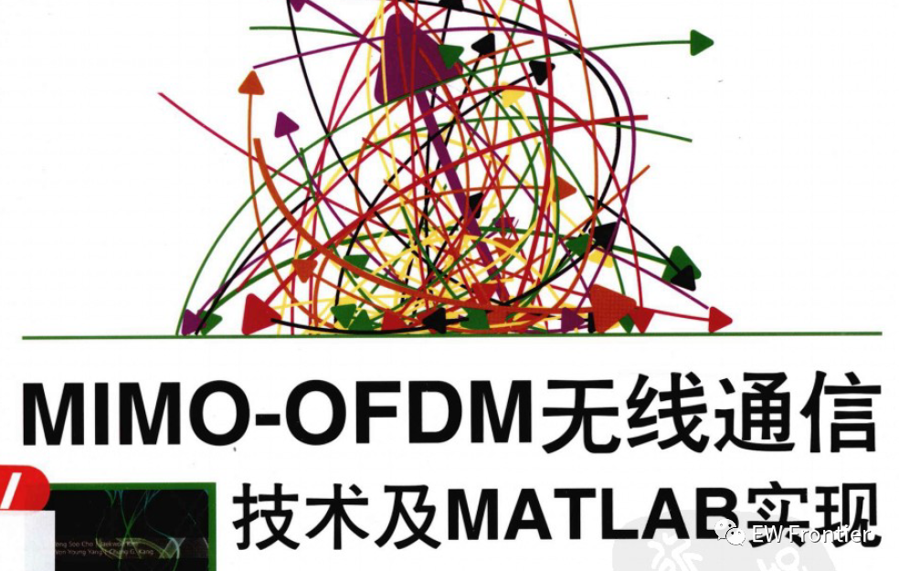
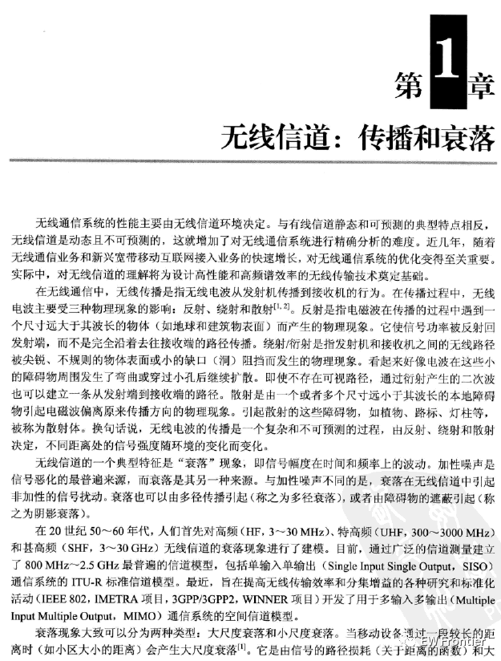
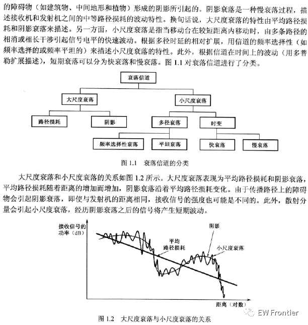
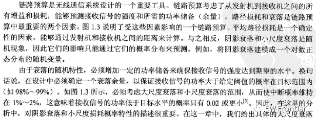
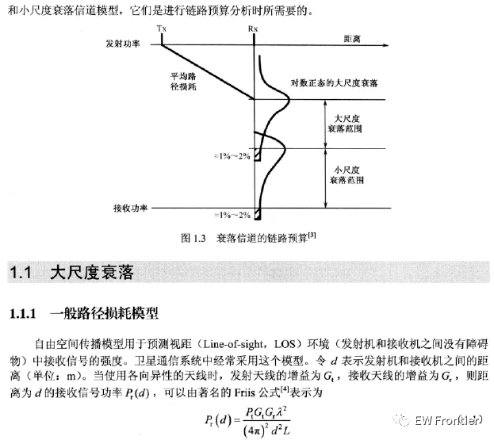
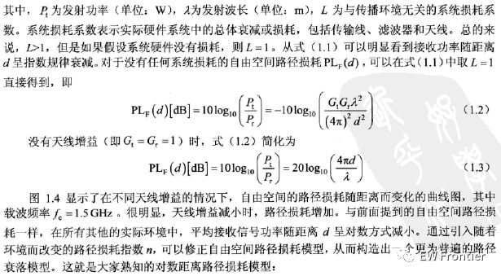
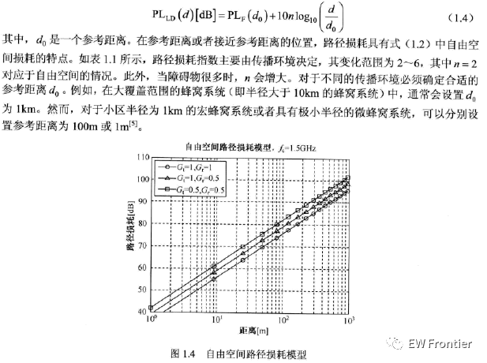
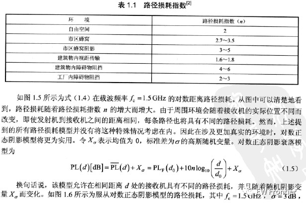
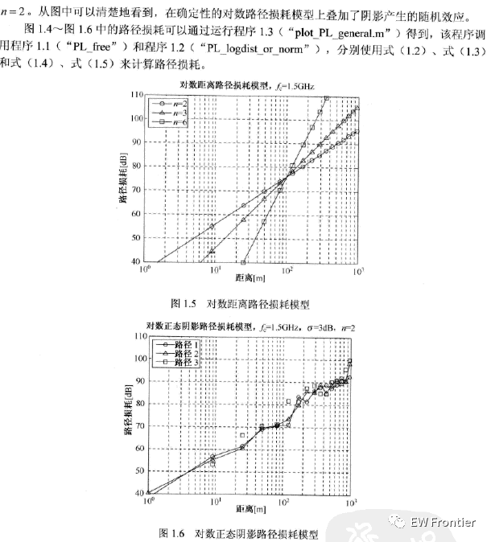
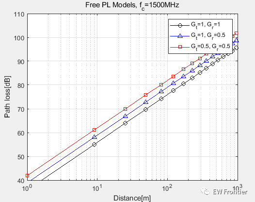
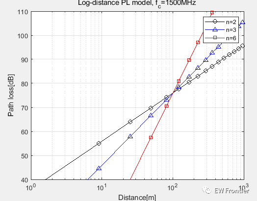
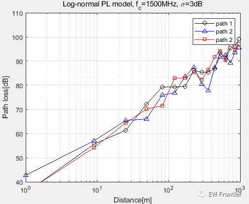

<!-- PAYMENT_BLOCK -->

## Get this dataset

- Payment link (Stripe): [Buy now](https://buy.stripe.com/3cs8yP7sY87d0vu9AB)
- Payment QR code: 

<!-- /PAYMENT_BLOCK -->
